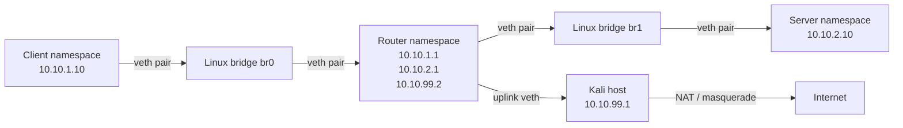

# Linux Virtual Network

A multi-namespace virtual network built on Kali Linux using Linux network namespaces, veth pairs, Linux bridges, routing tables, nftables, NAT, tcpdump, Wireshark, and Python automation.

This project demonstrates how packets move through isolated Linux network namespaces and how routing, forwarding, firewall rules, and NAT work together.

## Project Objectives

- Create isolated Linux network namespaces
- Connect namespaces using virtual Ethernet pairs
- Build Layer 2 networks using Linux bridges
- Configure Layer 3 routing between networks
- Enable IP forwarding
- Apply nftables firewall rules
- Configure NAT and masquerading
- Capture and analyze packets using tcpdump and Wireshark
- Automate setup, testing, and cleanup using Python

## Network Architecture



## Topology

```text
Client namespace
10.10.1.10/24
      |
    veth
      |
    br0
      |
Router namespace
10.10.1.1/24
10.10.2.1/24
10.10.99.2/24
      |
    br1
      |
Server namespace
10.10.2.10/24

Router uplink:
Router namespace: 10.10.99.2
Kali host:        10.10.99.1
```

## Addressing Plan

| Component | Interface | IP address | Purpose |
|---|---|---:|---|
| Client namespace | `eth0` | `10.10.1.10/24` | Client virtual network |
| Router namespace | `eth0` | `10.10.1.1/24` | Client-side router interface |
| Router namespace | `eth1` | `10.10.2.1/24` | Server-side router interface |
| Server namespace | `eth0` | `10.10.2.10/24` | Server virtual network |
| Router namespace | `lvc-up-r` | `10.10.99.2/24` | Router uplink |
| Kali host | `lvc-up-h` | `10.10.99.1/24` | Host-side uplink |

## Technologies Used

- Kali Linux
- Python 3
- Linux network namespaces
- Virtual Ethernet pairs
- Linux bridges
- IPv4 routing
- IP forwarding
- nftables
- NAT and masquerading
- tcpdump
- Wireshark
- Git and GitHub

## Requirements

Install the required packages:

```bash
sudo apt update

sudo apt install -y \
  iproute2 \
  nftables \
  tcpdump \
  wireshark \
  python3 \
  python3-pip \
  python3-venv \
  traceroute \
  iputils-ping \
  git
```

Root privileges are required because the project creates network namespaces, interfaces, bridges, routes, and firewall rules.

## Project Structure

```text
linux-virtual-network/
├── README.md
├── setup_network.py
├── cleanup_network.py
├── test_connectivity.py
├── firewall.nft
├── nat.nft
├── captures/
│   ├── client-server.pcap
│   └── nat.pcap
└── docs/
    ├── terminal-progress.md
    └── terminal-session.log
```

If your setup script is named `network_setup.py`, use that name instead of `setup_network.py` in the commands below.

## Create the Virtual Network

Run:

```bash
sudo python3 setup_network.py
```

The setup script creates:

- Three network namespaces
- Two Linux bridges
- Multiple veth pairs
- IP addresses
- Routing tables
- Router forwarding
- A router uplink
- Host forwarding
- NAT masquerading

## Verify Network Namespaces

```bash
sudo ip netns list
```

Expected namespaces:

```text
lvc-client
lvc-router
lvc-server
```

## Verify IP Addresses

Client namespace:

```bash
sudo ip netns exec lvc-client ip addr
```

Router namespace:

```bash
sudo ip netns exec lvc-router ip addr
```

Server namespace:

```bash
sudo ip netns exec lvc-server ip addr
```

## Verify Routing Tables

Client routing table:

```bash
sudo ip netns exec lvc-client ip route
```

Expected default route:

```text
default via 10.10.1.1
```

Router routing table:

```bash
sudo ip netns exec lvc-router ip route
```

Expected networks:

```text
10.10.1.0/24
10.10.2.0/24
10.10.99.0/24
default via 10.10.99.1
```

Server routing table:

```bash
sudo ip netns exec lvc-server ip route
```

Expected default route:

```text
default via 10.10.2.1
```

## Connectivity Tests

Test client-to-router connectivity:

```bash
sudo ip netns exec lvc-client ping -c 3 10.10.1.1
```

Test client-to-server routing:

```bash
sudo ip netns exec lvc-client ping -c 3 10.10.2.10
```

Test router-to-Kali connectivity:

```bash
sudo ip netns exec lvc-router ping -c 3 10.10.99.1
```

Test internet connectivity through NAT:

```bash
sudo ip netns exec lvc-client ping -c 3 1.1.1.1
```

## Automated Connectivity Tests

Run:

```bash
sudo python3 test_connectivity.py
```

The test script validates:

- Client-to-router connectivity
- Client-to-server routing
- Router-to-Kali connectivity
- Client-to-internet connectivity through NAT

Expected output:

```text
[PASS] Client → Router
[PASS] Client → Server
[PASS] Router → Kali host
[PASS] Client → Internet

All network tests passed.
```

## Firewall Testing

The router namespace can filter forwarded traffic using nftables.

Apply the firewall:

```bash
sudo ip netns exec lvc-router nft -f firewall.nft
```

Inspect the rules:

```bash
sudo ip netns exec lvc-router nft list ruleset
```

Test client-to-server connectivity:

```bash
sudo ip netns exec lvc-client ping -c 3 10.10.2.10
```

When ICMP traffic is blocked, the expected result is packet loss:

```text
3 packets transmitted, 0 received
```

Remove the firewall table:

```bash
sudo ip netns exec lvc-router nft delete table inet lvc_firewall
```

Test connectivity again:

```bash
sudo ip netns exec lvc-client ping -c 3 10.10.2.10
```

The ping should work again.

## NAT Configuration

The Kali host performs masquerading for traffic from the virtual networks:

```text
10.10.0.0/16 → Kali host → external interface → Internet
```

NAT changes the private source address of packets leaving Kali so that external systems see Kali’s physical network address instead of the private namespace address.

Inspect the NAT table:

```bash
sudo nft list table ip lvc_nat
```

The NAT rule uses:

```nft
ip saddr 10.10.0.0/16 masquerade
```

## Packet Capture

Capture traffic from all interfaces:

```bash
sudo tcpdump -i any -nn -w captures/client-server.pcap
```

Generate traffic from the client namespace:

```bash
sudo ip netns exec lvc-client ping -c 5 10.10.2.10
```

Stop the capture with:

```text
Ctrl + C
```

Inspect the capture using tcpdump:

```bash
sudo tcpdump -r captures/client-server.pcap -nn
```

Open the capture in Wireshark:

```bash
wireshark captures/client-server.pcap
```

## NAT Packet Capture

Find Kali’s external interface:

```bash
ip route show default
```

Example:

```text
default via 192.168.0.1 dev wlan0
```

Capture packets on the external interface:

```bash
sudo tcpdump -i wlan0 -nn -w captures/nat.pcap icmp
```

Replace `wlan0` with the actual interface shown on your system.

Generate internet traffic:

```bash
sudo ip netns exec lvc-client ping -c 5 1.1.1.1
```

Stop tcpdump:

```text
Ctrl + C
```

Read the capture:

```bash
sudo tcpdump -r captures/nat.pcap -nn
```

On the external interface, the source address should be Kali’s physical IP address rather than `10.10.1.10`. This demonstrates that NAT is working.

## Packet Path: Client to Server

```text
Application process
        ↓
Client socket
        ↓
Client namespace kernel
        ↓
Client routing table
        ↓
Client eth0
        ↓
Virtual Ethernet pair
        ↓
Linux bridge br0
        ↓
Router namespace eth0
        ↓
Router routing table
        ↓
Router namespace eth1
        ↓
Linux bridge br1
        ↓
Virtual Ethernet pair
        ↓
Server namespace eth0
        ↓
Server process
```

## Packet Path: Client to Internet

```text
Client namespace
        ↓
Client default route
        ↓
Router namespace
        ↓
Router default route
        ↓
Router uplink lvc-up-r
        ↓
Host uplink lvc-up-h
        ↓
Kali IP forwarding
        ↓
nftables masquerade rule
        ↓
Kali physical interface
        ↓
Internet gateway
        ↓
Internet
```

## Role of Each Component

### Network Namespace

A network namespace provides an isolated network environment with its own:

- Network interfaces
- IP addresses
- Routing tables
- Firewall rules
- Sockets
- Network processes

### Virtual Ethernet Pair

A veth pair behaves like a virtual network cable. Packets entering one end appear at the other end.

In this project, veth pairs connect:

- Client namespace to `br0`
- Router namespace to `br0`
- Router namespace to `br1`
- Server namespace to `br1`
- Router namespace to the Kali host

### Linux Bridge

A Linux bridge operates like a virtual Layer 2 switch. It forwards Ethernet frames between attached interfaces.

The bridges in this project are:

```text
br0: client network
br1: server network
```

### Router Namespace

The router namespace connects different IP networks:

```text
10.10.1.0/24
10.10.2.0/24
10.10.99.0/24
```

It uses its routing table to determine where packets should go.

### Uplink

The uplink connects the isolated router namespace to the Kali host:

```text
Router namespace → lvc-up-r → lvc-up-h → Kali host
```

Without the uplink, the virtual network can communicate internally but cannot reach the Kali host or the internet.

### nftables

nftables is used to:

- Block ICMP traffic
- Filter forwarded packets
- Apply NAT masquerading
- Inspect packet counters

## Cleanup

Remove the entire project network:

```bash
sudo python3 cleanup_network.py
```

The cleanup script removes:

- NAT rules
- Network namespaces
- veth interfaces
- Linux bridges
- Project-specific virtual links

Verify cleanup:

```bash
sudo ip netns list
```

```bash
ip link show | grep lvc
```

Both commands should return no project-related interfaces.

## Troubleshooting

### Namespace does not exist

Check existing namespaces:

```bash
sudo ip netns list
```

Recreate the network:

```bash
sudo python3 setup_network.py
```

### Ping to the server fails

Check router forwarding:

```bash
sudo ip netns exec lvc-router sysctl net.ipv4.ip_forward
```

Expected:

```text
net.ipv4.ip_forward = 1
```

Check routes:

```bash
sudo ip netns exec lvc-router ip route
```

### Internet ping fails

Check the router uplink:

```bash
sudo ip netns exec lvc-router ping -c 3 10.10.99.1
```

Check Kali forwarding:

```bash
sysctl net.ipv4.ip_forward
```

Check the NAT table:

```bash
sudo nft list table ip lvc_nat
```

Check Kali’s external interface:

```bash
ip route show default
```

### Firewall blocks traffic

Inspect firewall rules:

```bash
sudo ip netns exec lvc-router nft list ruleset
```

Remove the project firewall:

```bash
sudo ip netns exec lvc-router nft delete table inet lvc_firewall
```

## Learning Outcomes

This project demonstrates practical knowledge of:

- Linux networking internals
- Network namespace isolation
- Virtual Ethernet interfaces
- Layer 2 bridging
- Layer 3 routing
- Default gateways
- IP forwarding
- Firewall rule processing
- NAT and masquerading
- Packet capture and analysis
- Python-based network automation
- Linux troubleshooting

## Future Improvements

Possible extensions include:

- Add more client and server namespaces
- Configure routing across 20 virtual networks
- Add VLANs
- Add automated firewall testing
- Add TCP and UDP traffic tests
- Build a Python topology configuration file
- Add logging and metrics
- Add Docker network integration
- Add Kubernetes networking experiments
- Add automated packet-path diagrams
- Add CI tests for the Python scripts

## Author

Sanskruti Dhanani

This project was built as part of a networking, infrastructure, and network-automation portfolio.
